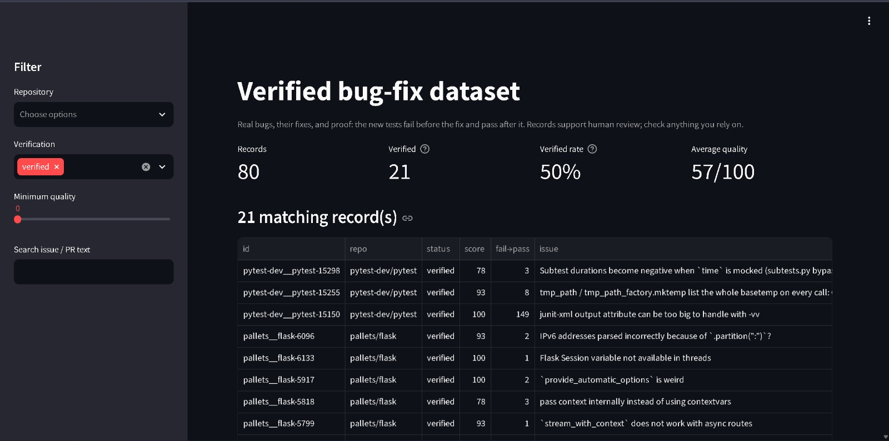
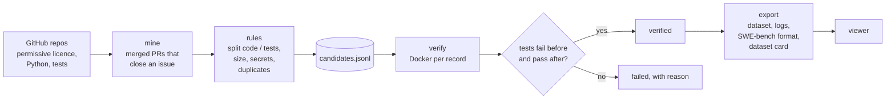

# bugfix-dataset

A pipeline that builds a **verified dataset of real software bugs** from
open-source Python projects: the issue that reported each bug, the pull
request that fixed it, the fix split into a code patch and a test patch, and
**proof from running the tests**: the new tests fail without the fix and pass
with it.

This is the kind of engineering data used to evaluate and train AI coding
models (the approach behind benchmarks like [SWE-bench](https://www.swebench.com/)).
Every record is reproducible, licence-aware, and scored for quality.



## Results (v1)

| | |
|---|---|
| Candidates mined | **80** from **2** repositories (pytest 58, Flask 22) |
| Verified records | **32** (Flask 18, pytest 14) |
| Verification rate, of records tried | Flask **82%** (18 of 22), pytest **70%** (14 of 20; 38 not tried yet) |
| Average quality score of released records | **91/100** |
| Licences | BSD-3-Clause 18, MIT 14 |
| Python versions used for verification | 3.12 (29), 3.11 (2), 3.10 (1) |
| Tests that fail before the fix and pass after | **1,002** in total; this count is inflated by a few records where the whole test file couldn't load before the fix (see Limitations) |

Download the dataset from [Releases](../../releases). A 3-record sample is in
[`examples/sample.jsonl`](examples/sample.jsonl).

## What one record looks like

```json
{
  "id": "pallets__flask-5637",
  "repo": "pallets/flask",
  "license": "BSD-3-Clause",
  "issue": {"number": 5636, "title": "...", "body": "...", "url": "..."},
  "pr": {"number": 5637, "title": "...", "url": "...", "merged_at": "..."},
  "base_commit": "the commit the fix starts from",
  "code_patch": "diff --git a/src/flask/... (the fix)",
  "test_patch": "diff --git a/tests/... (the new tests)",
  "verification": {
    "status": "verified",
    "fail_to_pass": ["tests.test_basic::test_..."],
    "pass_to_pass": ["..."],
    "python_version": "3.12.x"
  },
  "quality": {"score": 85, "reasons": ["+50 verified: tests fail before the fix and pass after", "..."]}
}
```

## How it works



1. **Mine** (`bugfix/mine.py`): one GraphQL query returns 50 merged PRs **with
   the issues GitHub has linked to them**, including links made in the PR's
   Development sidebar, which never appear in the PR text. Cheap checks run
   first, so a PR that's rejected usually costs at most one API call.
2. **Filter** (`bugfix/rules.py`): every inclusion rule is a small, tested
   function: permissive licences only; the fix must change Python code **and**
   tests; no other languages; at most 300 changed lines and 5 files; no
   secrets in the patches; duplicates (e.g. backports) removed by fingerprint.
   Every rejection is counted with its reason.
3. **Verify** (`bugfix/verify.py`, `bugfix/runner.py`): each record runs in its
   own Docker container (4 GB memory, 2 CPUs, 45-minute limit), so untrusted
   project code never runs on the host. The container fetches the commit
   before the fix, installs the project, applies **the new tests only**
   (they should fail), then **the fix** (they should pass, and nothing that
   passed before may break).
4. **Export** (`bugfix/export.py`): verified records, test logs, a
   SWE-bench-compatible file, statistics and a generated **dataset card**
   with licence attribution for every source repository.
5. **View** (`viewer/app.py`): a Streamlit app to browse, filter and inspect records.

## Problems solved along the way

Reproducing a bug fix from months or years ago is mostly about rebuilding
the world as it was. Each of these turned up as real failures, was diagnosed
from the logs, and is now covered by tests:

| Problem | Fix |
|---|---|
| Most fixes link their issue in GitHub's sidebar, not with "Fixes #12" | Read `closingIssuesReferences` from the GraphQL API; keywords as a backup |
| A PR's diff is relative to where its branch split off, not the base branch's latest commit | Start from the **merge base** (via the compare API), so patches apply |
| Today's libraries break old code (e.g. pytest 9 removed a private helper Flask's tests imported) | Install dependencies **as of the fix's merge date** (`uv --exclude-newer`) |
| Today's Python breaks old tooling (`ast.Str` warnings on 3.12 failing 2023 code) | Choose the **Python version by merge date**: newest release that was 6+ months old; one Docker image per version |
| One test file that can't import stopped the whole run | `--continue-on-collection-errors` |
| Tests inside example apps need those apps installed | Detect and install sub-projects |
| Projects that read their version from git tags can't, from a 1-commit download | `SETUPTOOLS_SCM_PRETEND_VERSION`, set high, because pytest refuses to test itself as "version 0.0.0" |
| Some suites need their own pytest options (pytest loads its `pytester` plugin that way) | Keep each project's options; drop them only if pytest can't use them |
| Patches written on Windows got `\r\n` line endings and stopped applying | Always write patches with `\n` |
| Git's read-only files on Windows broke clean-up between records | Make them writable, then delete |
| A shutdown mid-batch | Progress saved atomically after every record; `--retry` resumes |

## Quick start

Needs Python 3.11+, Git, Docker Desktop, and a GitHub token (public repos,
read-only).

```powershell
git clone https://github.com/nexusknox/bugfix-dataset.git
cd bugfix-dataset
python -m venv .venv
.\.venv\Scripts\Activate.ps1
pip install -r requirements.txt
copy .env.example .env      # then paste your token into .env
```

```powershell
python -m bugfix.cli discover --min-stars 5000 --limit 5     # find repos that qualify
python -m bugfix.cli mine pallets/flask --max-prs 200          # collect candidates
python -m bugfix.cli build-image                               # Docker images, one per Python version
python -m bugfix.cli verify --repo pallets/flask --limit 10    # prove each fix
python -m bugfix.cli stats                                     # progress so far
python -m bugfix.cli export                                    # write data/release/
streamlit run viewer/app.py                                    # browse the records
```

- API responses are cached in `cache/`, so re-running costs no quota.
- `verify` saves after every record; stop any time with Ctrl+C, resume with `--retry`.

## Project structure

```
bugfix/
  models.py     # the record schema
  rules.py      # inclusion rules: licences, issue links, code/test split, secrets, duplicates, quality
  github.py     # GitHub REST + GraphQL client: token, cache, paging, rate limits
  mine.py       # find merged, issue-linked fixes and build records
  store.py      # JSON Lines storage, atomic writes, de-duplication
  runner.py     # runs INSIDE Docker: fetch, install, test before/after (Python 3.8+)
  verify.py     # Docker orchestration, Python-by-date, the verified/failed decision
  export.py     # release files and the dataset card
  browse.py     # filtering for the viewer
  cli.py        # discover, mine, build-image, verify, export, stats
docker/Dockerfile
viewer/app.py   # Streamlit viewer
tests/          # 97 tests: fake GitHub API, real git + pytest runs of the container script
examples/sample.jsonl
```

## Testing

```powershell
pytest
```

The tests never call GitHub or Docker. The API is replaced by a fake that
answers like GitHub (including rate limits and paging), and the container
script is tested for real: it fetches a small local git repo with a bug,
applies a test patch, and checks the new test fails before the fix and passes
after it.

## Data, licences and privacy

- Only repositories under permissive licences (MIT, Apache-2.0, BSD, ISC and
  similar) are mined. Each record keeps its source licence, and the dataset
  card lists every repository with its licence for attribution.
- Emails and credentials are removed from issue text, PR text, commit
  messages and logs. Patches are never edited (that would break
  verification); a record whose patch contains a secret is dropped instead.
- The dataset itself isn't committed to git; it's published on the Releases page.

## Limitations

- Python and pytest only.
- Very old commits (roughly before 2019) often can't be installed any more,
  so the data leans towards recent fixes.
- Bugs that only appear on a newer Python than the one chosen for their date
  show up as "tests already pass" and are left out.
- Test IDs follow pytest's JUnit naming (`tests.test_app::test_x`), not file paths.
- If the new tests import something that only exists after the fix, the whole
  test file fails to load before it, so **every** test in that file counts as
  fail-to-pass (e.g. 149 for `pytest-dev__pytest-15150`), not just the ones
  about the bug.
- Verifying is slow for large projects (5–10 minutes per pytest record).
- "Verified" means the new tests prove the fix; it doesn't mean the fix is the best one.

## Future improvements

- Run several verifications in parallel
- Retry "tests already pass" records on the next newer Python
- Record test IDs as file paths (`tests/test_app.py::test_x`)
- More repositories and languages
- A held-out split for benchmarking AI coding models

## License

The code is MIT licensed, see [LICENSE](LICENSE). Dataset records keep the
licence of the repository each one came from.
